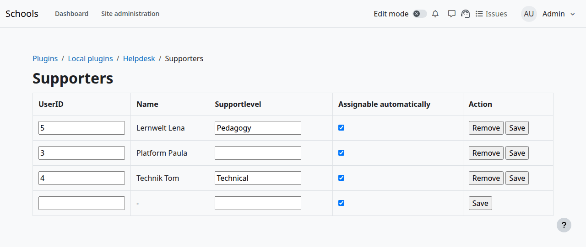
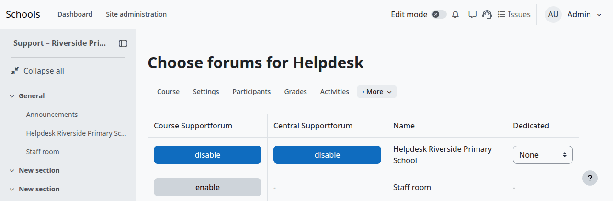
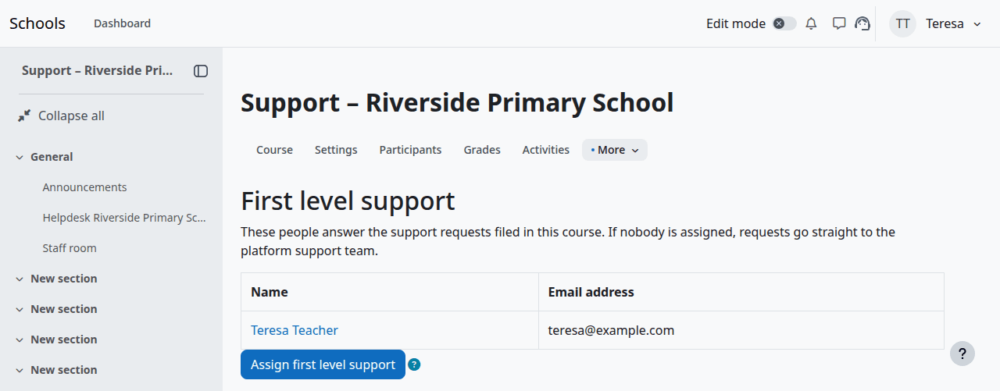
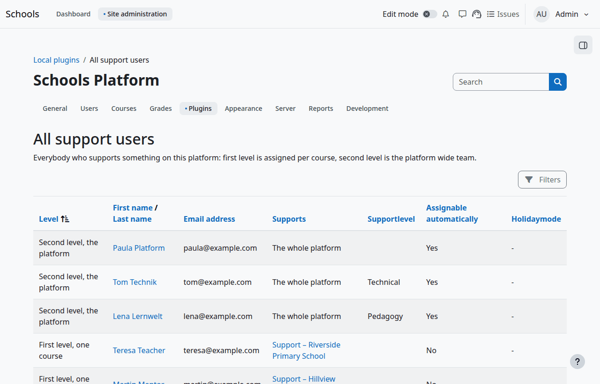
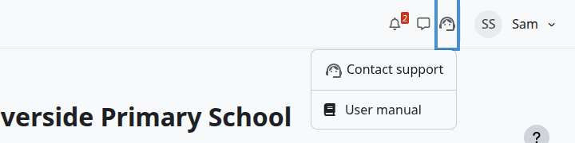
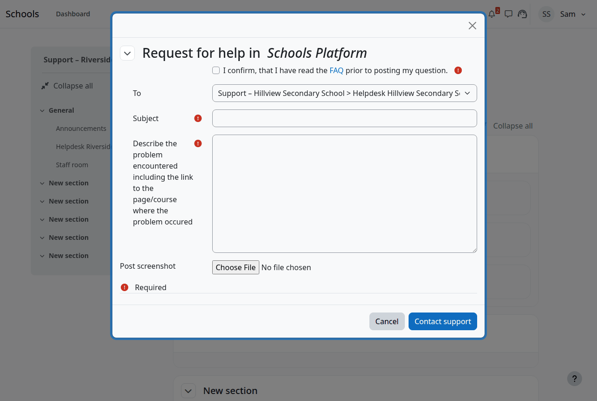
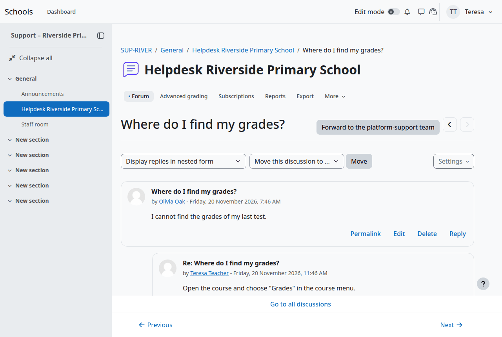
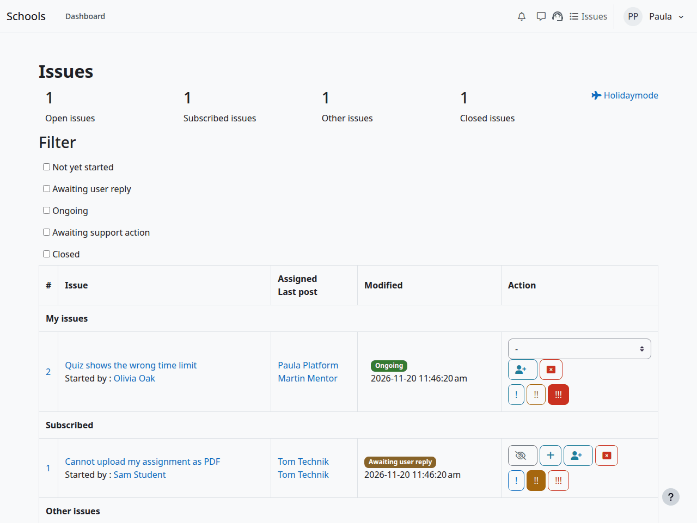
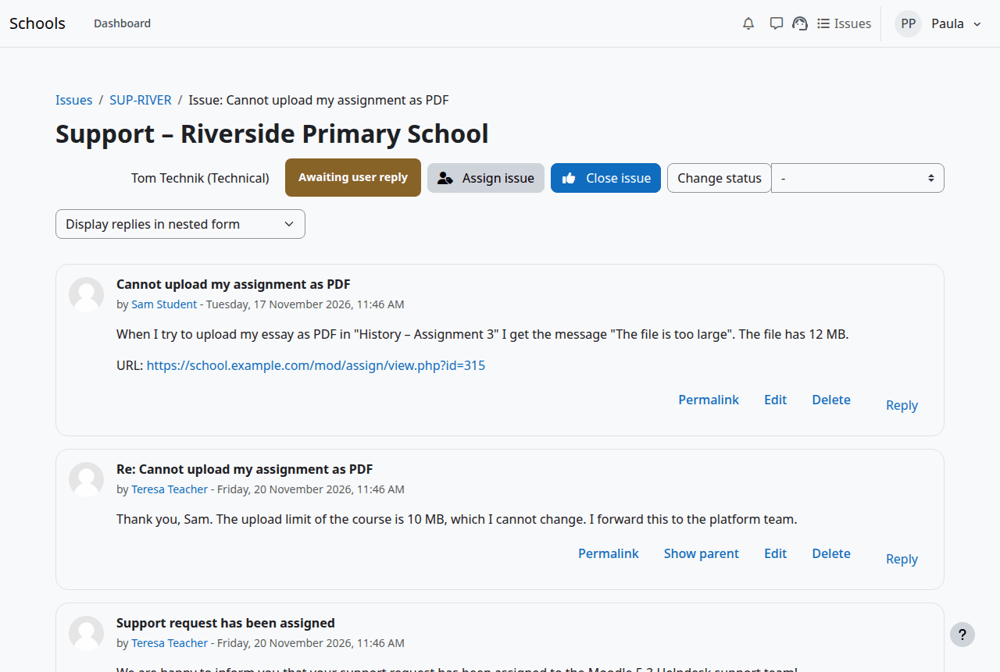

# Helpdesk (local_helpdesk)

Helpdesk turns Moodle forums into a support desk with up to three support levels. People ask for
help from any page with a help button in the navigation bar, optionally with a screenshot. The request
becomes a forum discussion in a support forum, where the first level support of that course answers it.
Whatever the first level cannot solve is forwarded to the platform support team (2nd and 3rd level),
which works on it in an issue list of its own.

It is made for platforms that host many organisations, for example many schools: every school gets its
own support course with its own first level support, and one platform team behind all of them.

Helpdesk is the successor of [local_edusupport](https://github.com/Wunderbyte-GmbH/moodle-local_edusupport).
Existing sites can migrate all their data, see [Migrating from local_edusupport](#migrating-from-local_edusupport).

## Features

* Help button in the navigation bar on every page, optionally a menu with extra links (manual, FAQ, ...).
* Requests are filed in a dialogue on the page where the problem occurred. The address of the page and a
  screenshot can be sent along.
* Requests are ordinary forum discussions: notifications, replies, attachments and permissions work as in
  every Moodle forum. With separate groups every person gets a private group with the support team.
* First level support per course, second and third level support for the whole platform.
* Issue list for the platform team: own issues, subscribed issues, other and closed issues, status, priority,
  assignment, filter and holiday mode.
* Optional: requests without logging in (answered by e-mail), predefined subjects, a page shown before the
  form, account managers, reminders, automatic deletion of old closed issues, spam protection.
* Privacy API, events, report builder report of all supporters, English and German language packs.

Helpdesk is free software. It needs no licence key, no subscription and no external service.

## Requirements

* Moodle 4.5 to 5.3
* PHP 8.1 or later
* No other plugins. Helpdesk builds on the core forum module (mod_forum).

## Installation

Install it like any other Moodle plugin:

* **From the Moodle plugins directory:** *Site administration > Plugins > Install plugins*, search for
  "Helpdesk", or download the ZIP file from https://moodle.org/plugins/local_helpdesk and upload it there.
* **With git:** clone the repository into `local/helpdesk` of your Moodle installation:

  ```
  git clone https://github.com/Wunderbyte-GmbH/moodle-local_helpdesk.git local/helpdesk
  ```

  Then open *Site administration > Notifications*, or run `php admin/cli/upgrade.php`.

The installation creates the role **Helpdesk Team**, which Helpdesk assigns to the supporters in the
support forums.

## Configuration

All settings are in *Site administration > Plugins > Local plugins > Helpdesk*.

### 1. Choose the platform support team (2nd and 3rd level)

*Site administration > Plugins > Local plugins > Helpdesk > Supporters*



Enter the user id of each member of the platform support team. Leave the support level empty for the
2nd level. Anything you enter as support level makes the person 3rd level support with that label, for
example "Technical" or "Pedagogy", so that the 2nd level knows to whom to forward special issues.
Untick *Assignable automatically* for people who should not be picked when an issue is forwarded.

### 2. Choose the support forums

Create a course with a forum of the type *Standard forum for general use* for every group of people you
support, for example one per school. As site administrator, open the course and choose *More > Choose
forums for Helpdesk* in the course navigation.



* **Course support forum** turns the forum into a support forum.
* **Central support forum** makes one forum the support forum of the whole site. Everybody who opens the
  help dialogue is enrolled into its course as a student, and a group is created for each person. This keeps
  requests private, so set the forum to *Separate groups*.
* **Dedicated** names the member of the platform team who is responsible for everything forwarded from
  this forum. Otherwise one of the assignable members is chosen at random.

Helpdesk protects support forums from being deleted by accident. Disable a support forum here before you
delete it.

### 3. Assign the first level support of each course

The first level support is assigned by name, per course. In the support course choose *More > First level
support*, press *Assign first level support* and pick the people who answer the requests of that course.



* Who may assign: everybody with the capability `local/helpdesk:assignsupporters` in the course, by default
  managers and teachers.
* Who can be assigned: people enrolled in the course who may start discussions in the forum and see hidden
  activities, which by default means the teaching staff of that course and not its students.

A support course without first level support hands every request to the platform team directly.

*Site administration > Plugins > Local plugins > All support users* lists both levels with the courses they
support.



On a site that comes from an earlier version, where the first level was everybody who could edit the course,
*Site administration > Plugins > Local plugins > Fill first level support from course rights* assigns exactly
those people once. It shows what it would do before it changes anything.

### 4. Further settings

| Setting | What it does |
| --- | --- |
| Extra links | Turns the help button into a menu with additional links, one per line: `name\|url\|icon\|target`. |
| FAQ link, confirm FAQ | Asks people to confirm that they have read the FAQ before they file a request. |
| Page before the support form | Shows a text, for example the most frequent questions, before the form. |
| Predefined subjects | A list of subjects to choose from instead of a free text field. |
| Show the support contacts | Names the first level support to the person filing a request. |
| Guest mode | Lets people who are not logged in file requests. They are answered by e-mail. |
| Spam protection | Limits how many requests a person or an address may file in a period. |
| Priorities, holiday mode, user links | Options of the issue list of the platform team. |
| Account managers | Lets people choose their account manager in the request form (button *Set account managers*). |
| Reminders | Reminds the responsible supporter of issues nobody has worked on for a while. |
| Notifications | Which e-mails people receive when an issue is forwarded, assigned or closed. |
| Deletion threshold | Removes closed issues from the issue list after the given time. The forum discussions stay. |

## Using Helpdesk

### Filing a request

The help button sits in the navigation bar next to the messages. With extra links it opens a menu.



*Contact support* opens the request form on the current page. People choose where the request goes (if they
have access to more than one support forum), enter a subject and a description, and can attach a screenshot.
The address of the page is sent along automatically.



People with access to no support forum send their request by e-mail to the support contact of the site
instead. People with the capability `local/helpdesk:canforward2ndlevel` (by default teachers) can send a
request to the platform team straight away.

### First level: answering in the course

The request is a discussion in the support forum of the course, and the first level support answers it there
like in any forum. If they cannot help, they forward it with *Forward to the platform-support team*. An
automatic post in the discussion makes this visible to the person who asked. The first level can take the
issue back with the same button.



### Platform team: the issue list

Members of the platform team find *Issues* in the navigation bar. The list groups the forwarded issues into
*My issues* (I am responsible), *Subscribed* (I am notified), *Other issues* and *Closed issues*. From here
they subscribe and unsubscribe, take over or assign an issue, set its priority and close it. *Holidaymode*
stops new issues from being assigned to oneself until a date.



The platform team does not need to be enrolled in the support courses. It only gets access to the discussions
that were forwarded to it. Opening an issue shows the discussion with the actions of the helpdesk: assign
the issue to somebody else, change its status, reply and close it.



When an issue is closed, the subscriptions of the platform team are removed and an automatic post tells the
first level and the person who asked. The first level can forward it again if needed.

## Capabilities

| Capability | Default | Meaning |
| --- | --- | --- |
| `local/helpdesk:assignsupporters` | Manager, teacher | Assign the first level support of a course. |
| `local/helpdesk:canforward2ndlevel` | Teacher | Forward a request to the platform team. |

## Privacy

Helpdesk implements the Moodle Privacy API. It stores who supports what, subscriptions to issues and, for
requests filed without logging in, the e-mail address given with the request. The requests themselves are
forum posts and are handled by the privacy provider of the forum.

## Migrating from local_edusupport

Helpdesk works the same way as local_edusupport. To move an existing site over:

1. Upgrade local_edusupport to version 2.8.0 or later.
2. Install local_helpdesk next to it. Do not configure any support forum in Helpdesk yet: the migration keeps
   the record ids and only runs while Helpdesk is empty.
3. Open *Site administration > Plugins > Local plugins > Migrate from eduSupport*. The
   page first shows how many records will be taken over, nothing is changed before you confirm. On large sites
   you can use the command line instead: `php local/helpdesk/cli/migrate_edusupport.php` (dry run) and
   `php local/helpdesk/cli/migrate_edusupport.php --run`.
4. Check the issues in Helpdesk, then uninstall local_edusupport.

What is taken over: support forums, issues, supporters, subscriptions, all settings, waiting reminders and
mails, and the users' notification preferences. The support team role and the guest ticket user are renamed
and reused, so role assignments in the support forums and the authors of forum posts stay as they are.

After the migration local_edusupport no longer knows any support forum and therefore does nothing any more;
its issues, supporters and subscriptions remain in its tables as a backup until you uninstall it. Until then
its help button is still shown next to the one of Helpdesk. Log entries and notifications that were already
sent keep their reference to local_edusupport.

## Support and development

* Issues and feature requests: https://github.com/Wunderbyte-GmbH/moodle-local_helpdesk/issues
* Maintained by [Wunderbyte GmbH](https://www.wunderbyte.at). Originally developed as local_edusupport by
  Digital Education Society and the Center for Learningmanagement.

## License

GNU GPL v3 or later, see [LICENSE](LICENSE).
